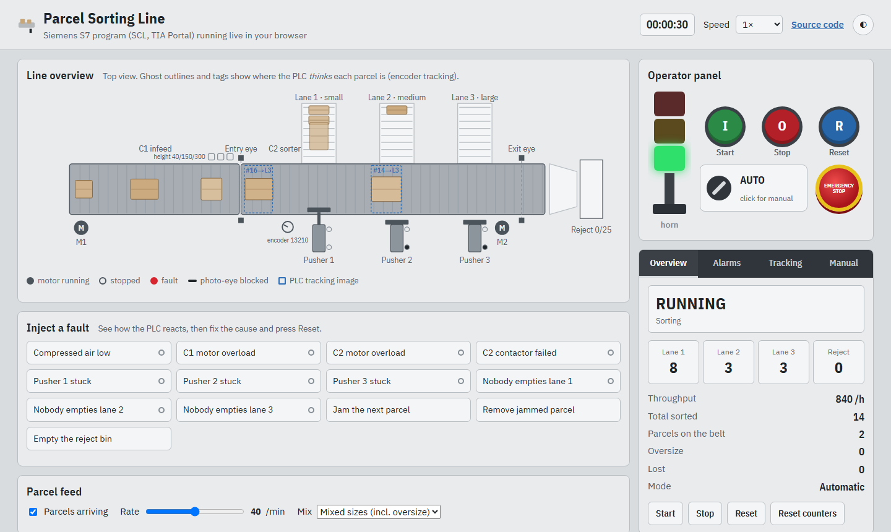
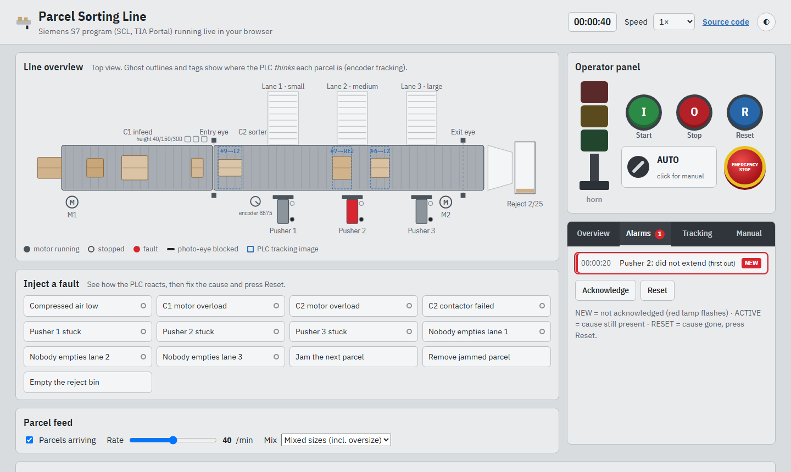
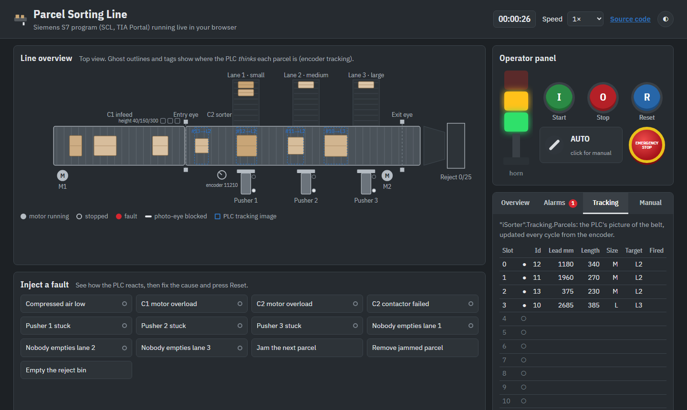
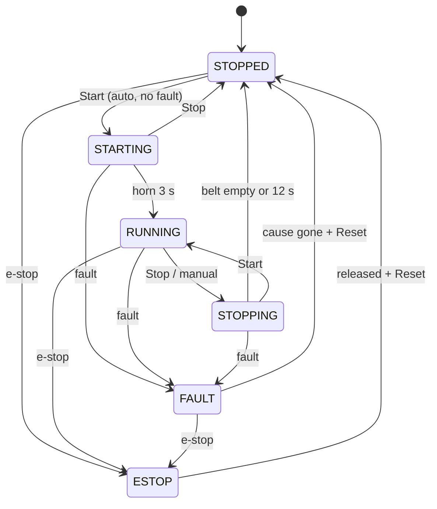

# 📦 Parcel Sorting Line

> A **Siemens S7 PLC program** (SCL, TIA Portal) for a parcel sorting conveyor. Parcels are measured at the entry and tracked along the belt with an encoder. Three pneumatic pushers divert them into lanes by size, and everything else goes to a reject chute. The program handles start-up warning, controlled stop, emergency stop, alarms with first-out, manual mode and production counters.
>
> The same logic runs **live in the browser** against a simulated machine, with an operator HMI, fault injection and an I/O monitor.

### ▶ [Open the live simulator](https://alexgoga213.github.io/Parcel-Sorting-Line/)


<p align="center">
  
  
</p>
<p align="center">
  
</p>

## The machine

```
            Lane 1 (S)      Lane 2 (M)      Lane 3 (L)
               ▲               ▲               ▲
  C1 infeed    │  C2 sorter    │               │              reject
 ═══════════╪══┴═══════════════┴═══════════════┴════════╪═══▶ chute / bin
            │       P1               P2              P3 │
       entry eye + 3 height beams    (pushers)       exit eye
            0 mm      1000 mm         2000 mm   3000 mm  3600 mm
```

| Equipment | Detail |
|---|---|
| C1 infeed, C2 sorter | 0.5 m/s, contactors with auxiliary feedback and motor protection breakers |
| Entry photo-eye + light curtain | Height beams at 40 / 150 / 300 mm give the size class; length is measured with the encoder |
| Encoder on C2 | High-speed counter, 1 pulse = 1 mm, used for all position tracking |
| Pushers P1–P3 | Pneumatic cylinders, 5/2 monostable valves, reed switches at both end positions |
| Lanes 1–3 | Accumulation lanes with a "lane full" photo-eye |
| Exit photo-eye, reject bin | Everything not diverted is counted at the exit; bin-full sensor |
| Operator panel | Start, Stop (NC), Reset with lamp, Auto/Manual key switch, emergency stop via safety relay, stack light and horn |

## What the program does

- **Tracking by encoder, not by timers.** Each parcel gets a slot in a 16-entry array when its leading edge breaks the entry eye. Its position is then advanced every cycle by the encoder delta, so tracking stays correct when the belt slows down or stops.
- **Measure and classify.** The highest beam broken while the parcel passes gives its size, and its length is known when the trailing edge clears the eye. Small, medium and large go to lanes 1, 2 and 3. Parcels that are too long, too flat (no beam broken), or bound for a closed lane go to the reject chute. Anything shorter than 60 mm is treated as debris.
- **Divert on time.** The pusher fires when the parcel centre reaches it, but only if the pusher is home and ready and its lane is not full. Otherwise the parcel continues to the reject chute instead of being pushed into a full lane.
- **Supervise every actuator.**
  - Motors fault on an overload trip, or when the contactor feedback does not follow the command within 1 s.
  - Pushers fault when they do not reach the extended or retracted end position in time.
- **Line state machine:** `STOPPED → STARTING (3 s horn) → RUNNING → STOPPING (empty the belt) → STOPPED`, plus `FAULT` and `E-STOP`. There is no automatic restart after a fault or an emergency stop.
- **Alarms.** There are 16 faults that stop the line and 5 warnings that do not.
  - Each alarm is latched and must be acknowledged; Reset only clears an alarm whose cause is gone.
  - The **first-out** alarm is shown, so the root cause is visible even when other faults follow.
- **Manual mode** (key switch, line stopped): jog each conveyor and fire each pusher from the HMI.
- **Counters:** parcels per lane, rejects, oversize, lost, and a rolling throughput in parcels per hour.



## Program structure

| Block | Type | Purpose |
|---|---|---|
| `FB_Sorter` | FB | Main program: I/O, calls everything below as multi-instances, HMI interface |
| `FB_LineControl` | FB | Line state machine |
| `FB_Tracking` | FB | Measuring, classification, encoder tracking, pusher timing, exit and lost-parcel checks |
| `FB_Pusher` | FB | One pneumatic stroke with end-position supervision |
| `FB_Motor` | FB | Contactor control with overload and feedback supervision |
| `FB_Alarms` | FB | Latch, acknowledge, reset, first-out |
| `FB_StackLight` | FB | Stack light and horn logic |
| `FB_Counters` | FB | Production counters and rolling throughput |
| `UDT_Parcel`, `UDT_LaneCounters` | UDT | Tracking slot, counters |
| `DB_Settings` | Global DB (retain) | Positions, length limits, timeouts, lanes open/closed |
| `DB_HMI` | Global DB | Commands from and status to the operator panel |
| `Main` (OB1), `Startup` (OB100), `iSorter` | OB / instance DB | Cycle call; after power loss the tracking is cleared |

The complete I/O list, with addresses and comments, is in [`plc/PLC_Tags.csv`](plc/PLC_Tags.csv). The same list is in [`plc/PLC_Tags.xlsx`](plc/PLC_Tags.xlsx) in the TIA Portal tag-table import format.

### Alarm list

| Bit | Fault (stops the line) | Bit | Fault / warning |
|---|---|---|---|
| 0 | Emergency stop | 11 | Pusher 3 did not retract |
| 1 | Compressed air low | 12 | Jam at the entry eye |
| 2–3 | C1 overload / no feedback | 13 | Reject bin full |
| 4–5 | C2 overload / no feedback | 14 | Reject chute blocked |
| 6–7 | Pusher 1 extend / retract | 15 | Tracking overflow |
| 8–9 | Pusher 2 extend / retract | 16–18 | ⚠ Lane 1 / 2 / 3 full |
| 10 | Pusher 3 did not extend | 19–20 | ⚠ Parcel lost / untracked parcel at exit |

## Import into TIA Portal

1. Create a project with an S7-1500 or S7-1200 CPU, V17 or newer.
2. **Tags:** in *PLC tags*, open a new tag table and use *Import* with `plc/PLC_Tags.xlsx`. You can also type the tags in from `PLC_Tags.csv`. Configure the high-speed counter so that its value appears at `%ID1000`.
3. **Blocks:** delete the default *Main [OB1]*, then go to *External source files* → *Add new external file*. Add every file in `plc/` in order (`01_` … `30_`).
4. Right-click each source and choose **Generate blocks from source**, then compile.
5. Test with **S7-PLCSIM**: force the inputs from a watch table, or connect an HMI to `DB_HMI`.

## Browser simulator

- `sim/plc.js` is a line-by-line JavaScript port of the SCL blocks, with the same names, states and timers.
- `sim/plant.js` models the physics: belts, parcel spacing, photo-eyes, light curtain, encoder, cylinder travel, lane unloading and the reject bin.
- `sim/app.js` draws the machine, the operator panel, a four-page HMI (overview, alarms, tracking, manual) and the I/O process image.

The HMI follows high-performance HMI practice (ISA-101): it uses neutral grays and saves colour for abnormal states.

Run it locally:

```bash
python tools/serve.py 8000
```

Then open http://localhost:8000.

## Tests

```bash
node --test tests/
```

The tests close the loop: the PLC program controls the simulated machine for minutes of production. They check that:

- every parcel ends up in the lane that matches its size;
- the PLC counters equal what physically happened;
- a stuck pusher, an emergency stop, a jam, a full lane, a failed contactor and a controlled stop each behave as specified.

## License

[MIT](LICENSE) © 2026 Goga Alex-Andrei
